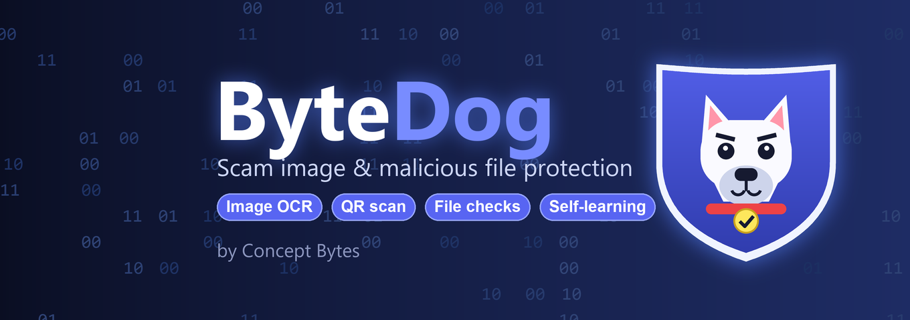

<p align="center"></p>

<p align="center">
  
  
  
  
</p>

**ByteDog** is a Discord moderation bot that catches scam images, QR-code phishing and malicious files before members fall for them, and **gets smarter from moderator feedback**. It reads the text inside images and animated GIFs/videos, checks attachments for disguised executables, and combines everything into one explainable score.

## How it works

Every message with media goes through a layered pipeline. Each layer adds points; crossing the threshold (default 50) triggers the configured actions.

| Layer | What it does |
|---|---|
| **Image OCR** | Reads text from images, GIF scenes and video frames with RapidOCR (ONNX, no cloud calls) |
| **Phrase rules** | Weighted regex rules across 14 scam categories: crypto, fake jobs, investment, giveaways, phishing, billing, account takeover, malware, sextortion, tech support and more. Tolerant of OCR noise |
| **Perceptual hashing** | Fingerprints known scam images so re-posts with small edits are still caught |
| **QR scanning** | Decodes QR codes (the "scan to log in" trick) and checks where they point |
| **File checks** | Spots executables, archives and scripts hiding behind picture extensions via magic bytes and appended payloads |
| **Link intelligence** | Learns scam domains, flags URL shorteners and look-alike domains, with an allow-list of trusted sites |
| **Naive Bayes model** | A small text classifier trained on moderator decisions. It stays off until it has enough examples of each class |
| **Spam-wave detection** | Notices the same content posted across channels or by many accounts |

## Learns from your server

- **Moderator buttons** on every alert: confirm or dismiss, and the bot updates its model
- **Right-click actions**: *Mark as scam* / *Not a scam* on any message
- **Learns from bans**: a banned user's suspicious images from the last hour become known scams
- **Community reports**: when enough members react with the flag emoji, the image goes to moderators for review
- **Self-tuning rules**: phrase weights adjust over time to match what is real in your community
- `/scamstats` shows what it has learned

All learning is stored in SQLite, so it survives restarts.

## Configurable response

Pick any combination of `delete`, `log`, `warn`, `timeout` and `jail` with the `ACTIONS` setting. Alerts go to a log channel with the verdict, the reasons behind the score, and a preview.

## Setup

```bash
pip install -r requirements.txt
cp .env.example .env      # add your bot token and channel/role IDs
python bot.py
```

The bot needs the **Message Content** and **Server Members** privileged intents, plus permission to read messages, manage messages and moderate members. See [.env.example](.env.example) for every option.

## Tests

```bash
python test_rules.py      # phrase rules
python test_memory.py     # link, template and rule learning
python test_images.py     # end-to-end on the images in samples/
```

## Project layout

| Path | Purpose |
|---|---|
| `bot.py` | Discord client, events, moderator UI, slash and context commands |
| `scambot/rules.py` | Weighted phrase rules and text normalisation |
| `scambot/decision.py` | Combines every signal into a score and verdict |
| `scambot/imaging.py` | Frame extraction, OCR, QR decoding, perceptual-hash store |
| `scambot/attachments.py` | File-type and hidden-payload checks |
| `scambot/learner.py` | Naive Bayes classifier |
| `scambot/memory.py` | Scam links, templates, rule tuning, recent-post tracking |

---

<sub>Built by [Concept Bytes](https://github.com/BucketSe).</sub>
